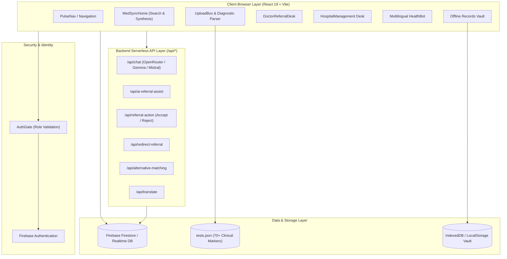
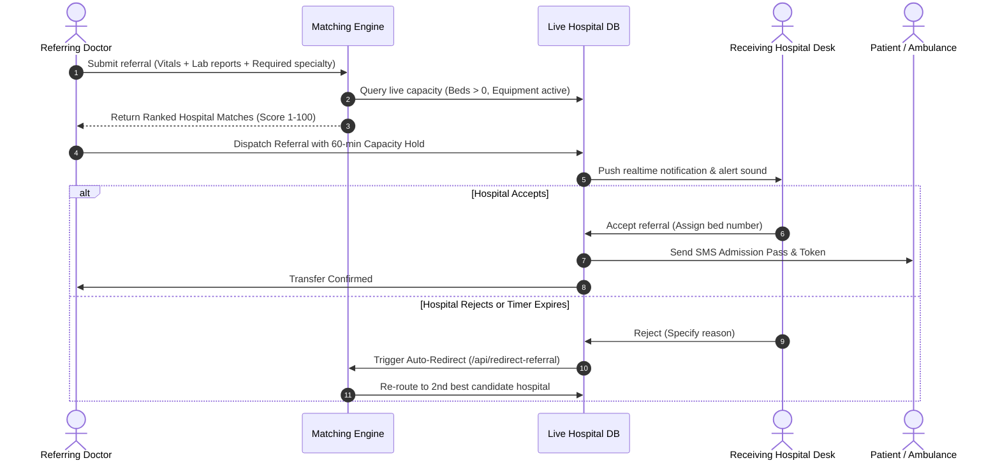

# ✚ MEDORA
### Smart Hospital Referral & Care-Coordination Platform
**Refer • Coordinate • Care**

Medora is an intelligent healthcare platform that connects patients with suitable hospitals based on treatment capabilities, specialist availability, medical equipment, and real-time bed and ICU capacity.

It enables doctors to create structured digital referrals, hospitals to accept or reject requests, and patients to track their referral journey. If a hospital cannot accommodate a patient, Medora intelligently identifies suitable alternatives, reducing treatment delays and eliminating repeated hospital searches.

## 🚀 KEY FEATURES

🏥 **1. Real-Time Hospital Insights**
- Find hospitals based on treatment capabilities.
- Check specialist availability.
- Access medical equipment information.
- Track real-time bed and ICU capacity.

📋 **2. Structured Digital Referrals**
- Doctors can create digital referral requests.
- Hospitals can accept or reject referrals.
- Patients can track their referral status.

🔄 **3. Smart Hospital Alternatives**
- Identify alternative hospitals when the preferred hospital is unavailable.
- Match patients with suitable hospitals based on their medical requirements.
- Reduce delays in finding appropriate treatment.

📄 **4. AI Medical Report Explainer**
- Upload and analyze medical reports.
- Understand complex medical terminology in simple language.
- Get easy-to-understand explanations of test results.

💰 **5. Hospital Bill Comparison**
- Compare estimated treatment costs across hospitals.
- Understand differences in hospital pricing.
- Help patients make informed financial decisions.

🤖 **6. AI Healthcare Chatbot**
- Get instant answers to general healthcare queries.
- Receive basic healthcare guidance.
- Navigate platform features with an AI-powered assistant.

## 🎯 OUR MISSION

To simplify hospital referrals, improve healthcare accessibility, and ensure that every patient finds the right care at the right place without unnecessary delays.

### 💜 MEDORA
**Smarter Referrals. Better Care. A Healthier Tomorrow.**

---

## 🛠 Architecture, Specification & Technical Reference

---

## 📌 Table of Contents
1. [System Overview & Core Philosophy](#1-system-overview--core-philosophy)
2. [High-Level Architecture](#2-high-level-architecture)
3. [Frontend Architecture & Component Registry](#3-frontend-architecture--component-registry)
4. [Backend Architecture & Serverless API Reference](#4-backend-architecture--serverless-api-reference)
5. [Authentication & Role-Based Access Control (RBAC)](#5-authentication--role-based-access-control-rbac)
6. [Core Workflows & State Machines](#6-core-workflows--state-machines)
7. [Algorithmic Engines & Business Logic](#7-algorithmic-engines--business-logic)
8. [Database Schemas & Data Models](#8-database-schemas--data-models)
9. [Multilingual Localization System](#9-multilingual-localization-system)
10. [Environment Variables & Setup Guide](#10-environment-variables--setup-guide)
11. [Blueprint for Porting to a New Architecture](#11-blueprint-for-porting-to-a-new-architecture)

---

## 1. System Overview & Core Philosophy

**MediSync AI** (with **Relief Laser Health** as its flagship surgical MVP) is an end-to-end clinical intelligence and hospital referral orchestration network. It bridges the gap between diagnostic clinics, primary care doctors (GPs), and receiving tertiary/daycare surgical centers.

### The Problem It Solves
- **Hospital Bouncing & Golden Hour Loss**: Critical and surgical patients are frequently bounced between hospitals due to unknown bed, ICU, or surgeon availability.
- **Diagnostic Incomprehensibility**: Patients cannot understand their lab reports, causing anxiety and delayed clinical action.
- **Fragmented Referrals**: Doctors coordinate transfers via phone calls, losing critical lab data and vital histories.

### The Three Operational Pillars
1. **Diagnostic Perception**: Ingests, parses, and translates lab reports (PDF/images) into plain-language bilingual summaries and objective risk scores entirely client-side or via Google AI.
2. **Deterministic Capacity Matching**: Connects hospitals into a real-time bed and operating theater (OT) network, ranking destinations using spatial proximity (Haversine), clinical specialty matching, and live capacity gates.
3. **Closed-Loop Referral Handshake**: Enables doctors to send complete clinical dossiers directly to hospital triage desks with instant SMS/push notifications, bed holds, and one-click redirects.

---

## 2. High-Level Architecture



---

## 3. Frontend Architecture & Component Registry

The frontend is a single-page application built with **React 19**, **Vite**, and modular CSS. It uses vanilla state hooks, context providers, and real-time Firestore listeners.

### Directory Layout
```text
src/
├── App.jsx                     # Root router, active tab switcher, and sample report loader
├── App.css                     # Global design system, typography, animations, responsive breakpoints
├── AuthGate.jsx                # Multi-role authentication modal and session controller
├── i18n.js                     # i18next configuration
├── firebase.js                 # Firebase Client SDK initialization
├── components/
│   ├── AttentionCard.jsx       # Alert card for lab values > 25% outside reference range
│   ├── BillComparator.jsx      # Medical bill scanner and package price comparison
│   ├── CostHubPage.jsx         # Unified cost intelligence, surgery packages, bill analyzer
│   ├── DoctorReferralDesk.jsx  # Doctor portal: patient referral form, hospital matching, case tracking
│   ├── HealthBot.jsx           # Voice & text conversational AI with Markdown formatting
│   ├── HealthHubPage.jsx       # Tab wrapper for HealthBot, HealthLibrary, and OfflineRecordsVault
│   ├── HealthLibrary.jsx       # Searchable catalog of 70+ laboratory tests with normal ranges
│   ├── HospitalManagement.jsx  # Hospital portal: live bed capacity editor, incoming referral triage
│   ├── HospitalPriceCompare.jsx# Package comparison across hospitals for daycare & laser surgeries
│   ├── Login.jsx               # Quick demo account switcher and credentials form
│   ├── MedSyncHome.jsx         # Landing page: natural language search, emblem pulse, clinical synthesis
│   ├── NotificationCenter.jsx  # Role-filtered notifications popover with unread counter
│   ├── OfflineRecordsVault.jsx # Client-side encrypted report storage (localStorage/IndexedDB)
│   ├── PatientDashboard.jsx    # Patient portal: my referrals, admission passes, active queue status
│   ├── PulseNav.jsx            # Dynamic top navigation bar with role badges and tab items
│   ├── ReliefLaserHealth.jsx   # Flagship surgical daycare MVP showcase
│   ├── ResultCard.jsx          # Individual lab biomarker card with low/normal/high slider
│   ├── RiskDashboard.jsx       # Predictive Patient Deterioration Matrix (NEWS2/qSOFA scores)
│   ├── RiskPage.jsx            # Full risk stratification overview tab
│   ├── Splash.jsx              # App boot-up branding screen
│   ├── Summary.jsx             # Diagnostic summary stats (total tests, normal, abnormal, attention)
│   ├── SuperAdminDashboard.jsx # System-wide audit log, hospital verification, and network metrics
│   └── UploadBox.jsx           # Drag-and-drop PDF/image report upload box
├── context/
│   └── LanguageContext.jsx     # Active language state and localized translation helper
├── data/
│   ├── tests.json              # 70+ clinical lab tests with units, ranges, and explanations
│   ├── hospitalPackages.json   # Surgical package costs by procedure and hospital tier
│   └── sampleBills.json        # Benchmark hospital bills for discrepancy comparison
├── locales/
│   ├── translations.js         # Core translations (English, Hindi, Bengali, Tamil, Telugu, Marathi)
│   └── additionalLanguages.js  # Extended translations (Gujarati, Kannada, Malayalam, Punjabi)
├── services/
│   ├── aiReferralService.js    # Client proxy for AI referral assist and note parsing
│   ├── hospitalService.js      # CRUD operations and real-time subscription for hospitals
│   ├── matchingEngine.js       # Mathematical scoring engine for hospital-referral matching
│   ├── notificationService.js  # Cross-stakeholder notification dispatch and subscription
│   └── referralService.js      # Referral creation, status updates, capacity hold sweeps
└── utils/
    ├── analyze.js              # Lab test deviation and status classifier
    ├── extractText.js          # PDF.js text extractor
    ├── formatMarkdown.jsx      # Safe Markdown renderer (bold, headings, lists, code blocks)
    ├── multilingualBot.js      # Fallback offline health query engine
    ├── offlineStorage.js       # Offline report caching utility
    ├── parseReport.js          # Regex & alias matching engine for medical text
    └── riskEngine.js           # Multi-parameter syndromic deterioration scoring
```

---

## 4. Backend Architecture & Serverless API Reference

All backend logic is implemented as **Vercel Serverless Functions (Node.js)** inside the `/api` directory. They handle external AI provider calls, secure database operations, and clinical validations.

### Endpoint 1: `/api/chat`
* **Purpose**: General conversational AI, clinical lab report interpretation, and multilingual dialogue.
* **Method**: `POST`
* **Model Hierarchy**: Primary `mistralai/mistral-saba` ➔ Fallback `google/gemma-3-27b-it` ➔ `google/gemini-2.5-flash` ➔ `meta-llama/llama-3.3-70b-instruct`.
* **Request Payload**:
  ```json
  {
    "messages": [
      { "role": "user", "content": "What does my creatinine of 1.8 mean?" }
    ],
    "reportContext": [
      { "name": "Serum Creatinine", "value": 1.8, "unit": "mg/dL", "status": "high", "low": 0.7, "high": 1.3 }
    ],
    "language": "en",
    "stream": true
  }
  ```
* **Response**:
  * **When `stream: true`**: Server-Sent Events (`text/event-stream`) streaming OpenRouter SSE chunks.
  * **When `stream: false`**:
    ```json
    {
      "reply": "Your Serum Creatinine of 1.8 mg/dL is elevated above the normal range...",
      "model": "mistralai/mistral-saba",
      "usage": { "prompt_tokens": 120, "completion_tokens": 85 }
    }
    ```

### Endpoint 2: `/api/ai-referral-assist`
* **Purpose**: Parses unstructured doctor notes into structured clinical entities, calculates an urgency score (1–10), and extracts required hospital infrastructure.
* **Method**: `POST`
* **Request Payload**:
  ```json
  {
    "notes": "45yo male with severe acute chest pain, ST elevation on ECG, BP 90/60, needs cath lab immediately",
    "vitals": { "bp": "90/60", "heartRate": 115, "spo2": 93 },
    "language": "en"
  }
  ```
* **Response**:
  ```json
  {
    "primaryDiagnosis": "Acute ST-Elevation Myocardial Infarction (STEMI)",
    "urgencyScore": 9.5,
    "urgencyLevel": "CRITICAL",
    "requiredSpecialties": ["CARDIOLOGY", "INTERVENTIONAL_CARDIOLOGY"],
    "requiredFacilities": ["CATH_LAB", "ICU_VENTILATOR", "CARDIAC_MONITOR"],
    "suggestedTransferTimeMinutes": 30,
    "clinicalSummary": "Hemodynamically unstable patient with acute coronary syndrome needing immediate percutaneous intervention."
  }
  ```

### Endpoint 3: `/api/referral-action`
* **Purpose**: Hospital staff accepts, rejects, or holds an incoming patient referral.
* **Method**: `POST`
* **Request Payload**:
  ```json
  {
    "referralId": "ref_1794633001",
    "hospitalId": "hosp_fortis_delhi",
    "action": "ACCEPT",
    "reason": "Cath lab prepared; bed reserved in CCU-2",
    "staffName": "Dr. A. Sharma",
    "staffEmail": "asharma@fortis.med",
    "bedHoldExpiresMinutes": 60
  }
  ```
* **Response**:
  ```json
  {
    "success": true,
    "status": "ACCEPTED",
    "referralId": "ref_1794633001",
    "holdExpiresAt": 1794636601000,
    "admitToken": "MED-ADMIT-7842"
  }
  ```

### Endpoint 4: `/api/redirect-referral`
* **Purpose**: Automatically reroutes a rejected or expired referral to the next best alternative hospital.
* **Method**: `POST`
* **Request Payload**:
  ```json
  {
    "referralId": "ref_1794633001",
    "currentHospitalId": "hosp_fortis_delhi",
    "rejectionReason": "Emergency ICU beds fully occupied"
  }
  ```
* **Response**:
  ```json
  {
    "success": true,
    "newHospitalId": "hosp_max_saket",
    "newHospitalName": "Max Super Speciality Hospital",
    "distanceKm": 4.8,
    "transferNotified": true
  }
  ```

### Endpoint 5: `/api/alternative-matching`
* **Purpose**: Runs the deterministic matching engine against live hospital inventory to find top 3 alternative candidate hospitals.
* **Method**: `POST`
* **Request Payload**:
  ```json
  {
    "specialty": "CARDIOLOGY",
    "urgencyScore": 9.0,
    "location": { "lat": 28.5355, "lng": 77.2410 },
    "excludeHospitalIds": ["hosp_fortis_delhi"]
  }
  ```
* **Response**:
  ```json
  {
    "candidates": [
      {
        "hospitalId": "hosp_max_saket",
        "name": "Max Super Speciality Hospital",
        "distanceKm": 3.4,
        "availableIcuBeds": 3,
        "matchScore": 94.5,
        "matchRationale": "Has 3 available cardiac ICU beds and on-duty interventional cardiologist."
      }
    ]
  }
  ```

---

## 5. Authentication & Role-Based Access Control (RBAC)

Authentication is handled via **Firebase Authentication** combined with a custom role-gating controller (`src/AuthGate.jsx`).

### Supported Roles

| Role | Access Level | Primary Dashboard Views | Capabilities |
| :--- | :--- | :--- | :--- |
| **`doctor`** | Clinician / Referring Physician | `DoctorReferralDesk`, `RiskDashboard`, `Diagnostic Report` | Create referrals, attach lab reports, track live patient transfers, view deterioration risk. |
| **`hospital`** | Hospital Emergency / Admin Staff | `HospitalManagement`, `DoctorReferralDesk` | Accept/reject referrals, update live bed/ICU/ventilator counts, manage hold timers. |
| **`patient`** | Patient / Caregiver | `PatientDashboard`, `HealthHubPage`, `CostHubPage` | View active admission passes, chat with AI, inspect lab reports, compare surgery costs. |
| **`admin`** | Super Administrator | `SuperAdminDashboard`, All views | System audit logs, hospital verification, fraud monitoring, referral override. |

### Session Management
- **Demo Switcher**: For hackathons and evaluation, users can switch roles instantly in `AuthGate.jsx` or log in with verified Firebase credentials.
- **Data Isolation**: Referrals are scoped by `referringDoctorEmail` and `hospitalId` so clinicians only access authorized patient records.

---

## 6. Core Workflows & State Machines

### Workflow A: The Referral Handshake (Doctor ➔ Hospital)



### Workflow B: Client-Side Diagnostic Report Decoding

```mermaid
flowchart LR
    A["Uploaded PDF / Image"] --> B["PDF.js text extraction"]
    B --> C["parseReport.js (Regex + Alias mapping)"]
    C --> D["tests.json (70+ Clinical Markers)"]
    D --> E["analyze.js (Calculate % deviation)"]
    E --> F["Categorize: Low / Normal / High / Attention"]
    F --> G["riskEngine.js (Calculate Deterioration Score)"]
    G --> H["Render UI: ResultCards + RiskDashboard"]
```



---

## 7. Algorithmic Engines & Business Logic

### 1. Deterministic Hospital Matching Algorithm (`matchingEngine.js`)

The match score is calculated mathematically using weighted criteria to eliminate clinical bias:

$$\text{MatchScore} = (w_{\text{spec}} \cdot S_{\text{spec}}) + (w_{\text{cap}} \cdot S_{\text{cap}}) + (w_{\text{dist}} \cdot S_{\text{dist}}) + (w_{\text{urg}} \cdot S_{\text{urg}})$$

Where:
- **Specialty Score ($S_{\text{spec}}$)**: Binary $100$ or $0$ depending on whether the hospital has verified on-call specialists for the required condition.
- **Capacity Score ($S_{\text{cap}}$)**: Percentage of available beds:
  $$S_{\text{cap}} = \min\left(100, \frac{\text{Available ICU Beds}}{\text{Total ICU Beds}} \times 100\right)$$
- **Distance Score ($S_{\text{dist}}$)**: Derived from the **Haversine Formula**:
  $$d = 2R \arcsin\left(\sqrt{\sin^2\left(\frac{\Delta\phi}{2}\right) + \cos\phi_1\cos\phi_2\sin^2\left(\frac{\Delta\lambda}{2}\right)}\right)$$
  Score drops linearly with distance: $\max(0, 100 - (d_{\text{km}} \times 2.5))$.
- **Hard Gate Rule**: If a critical referral requires an ICU ventilator and the hospital has $0$ ventilators available, the hospital is **strictly pruned ($Score = 0$)**, regardless of proximity.

### 2. Patient Deterioration Risk Engine (`riskEngine.js`)
Calculates an objective syndromic risk score ($1.0 - 10.0$):
- Integrates modified **NEWS2 (National Early Warning Score)** based on systolic blood pressure, heart rate, and $SpO_2$.
- Adds weighted biomarker multipliers for critical lab markers:
  - Acute Creatinine elevation ($> 2.0\text{ mg/dL}$): $+2.0$ points (Renal risk).
  - Troponin-I elevation ($> 0.04\text{ ng/mL}$): $+3.5$ points (Cardiac risk).
  - Severe Thrombocytopenia (Platelets $< 50,000$): $+2.0$ points (Bleeding risk).

### 3. Markdown Formatting Engine (`formatMarkdown.jsx`)
Parses incoming LLM responses on the fly:
- Resolves `**bold**` into styled `<strong>` elements.
- Strips `#` prefixes and renders headings (`###`, `##`, `#`) with Fraunces serif typography.
- Renders bullet lists (`-`, `*`, `•`) and numbered items (`1.`) into structured indented blocks.
- Formats code fences (```` ```python ... ``` ````) into dark code blocks.

---

## 8. Database Schemas & Data Models

### 1. Hospital Collection (`hospitals`)
```json
{
  "id": "hosp_max_saket",
  "name": "Max Super Speciality Hospital",
  "city": "New Delhi",
  "lat": 28.5273,
  "lng": 77.2140,
  "availableBeds": 42,
  "occupiedBeds": 158,
  "availableEmergencyBeds": 6,
  "icuBedCapacity": 25,
  "icuFacilities": {
    "availableBeds": 4,
    "hasVentilators": true,
    "availableVentilators": 2,
    "hasCathLab": true,
    "hasNeonatalIcu": true
  },
  "specialties": ["CARDIOLOGY", "ONCOLOGY", "PROCTOLOGY_LASER", "NEPHROLOGY"],
  "schemes": ["PM_JAY_AYUSHMAN", "CGHS", "PRIVATE_CASHLESS"],
  "lastUpdated": 1794633000000,
  "lastUpdatedBy": "Dr. V. Kapoor"
}
```

### 2. Referral Collection (`referrals`)
```json
{
  "id": "ref_8921",
  "patientName": "Sunita Verma",
  "patientAge": 52,
  "patientGender": "Female",
  "referringDoctorEmail": "dr.gupta@delhiclinic.com",
  "referringDoctorName": "Dr. S. Gupta",
  "hospitalId": "hosp_max_saket",
  "hospitalName": "Max Super Speciality Hospital",
  "status": "PENDING",
  "urgencyScore": 8.5,
  "urgencyLevel": "HIGH",
  "primaryDiagnosis": "Acute Cholecystitis with Sepsis",
  "requiredSpecialty": "GENERAL_SURGERY",
  "requiredEquipment": "ICU_VENTILATOR",
  "vitals": { "bp": "100/65", "heartRate": 108, "spo2": 94 },
  "attachedReports": [
    { "name": "Ultrasound_Abdomen.pdf", "size": "1.4MB" }
  ],
  "holdExpiresAt": 1794636600000,
  "createdAt": 1794633000000
}
```

### 3. Notification Collection (`notifications`)
```json
{
  "id": "notif_441",
  "recipientRole": "hospital",
  "hospitalId": "hosp_max_saket",
  "title": "Incoming Urgent Referral",
  "message": "Dr. S. Gupta referred patient Sunita Verma (Urgency 8.5/10)",
  "type": "REFERRAL_NEW",
  "referralId": "ref_8921",
  "read": false,
  "timestamp": 1794633001000
}
```

---

## 9. Multilingual Localization System

The platform supports **10 Indian languages** via a custom two-tier localization architecture (`LanguageContext.jsx`, `translations.js`, and `additionalLanguages.js`):

1. **Tier 1 (Core Tested)**: English (`en`), Hindi (`hi`), Bengali (`bn`), Tamil (`ta`), Telugu (`te`), Marathi (`mr`).
2. **Tier 2 (Extended Regional)**: Gujarati (`gu`), Kannada (`kn`), Malayalam (`ml`), Punjabi (`pa`).

### How Translation Works
- **UI Elements**: Synchronized via `useLanguage()` with dynamic key resolution (`t("bot.sendInquiry")`).
- **AI LLM Output**: The backend `/api/chat` passes the target language in the system prompt (`You MUST reply entirely and fluently in Hindi (हिन्दी)`), ensuring that even complex medical values are translated accurately into native idioms while keeping clinical units ($mg/dL$, $g/dL$) recognizable.
- **Voice Synthesis**: Integrated with the browser's `SpeechSynthesisUtterance` mapped to native voice locales (e.g. `hi-IN`, `ta-IN`).

---

## 10. Environment Variables & Setup Guide

### Local Development Setup

1. **Clone the repository**:
   ```bash
   git clone https://github.com/princekumar/medreport.git
   cd medreport
   ```

2. **Install dependencies**:
   ```bash
   npm install
   ```

3. **Configure Environment Variables**:
   Create a `.env.local` file in the root directory:
   ```env
   # OpenRouter API Key for AI features (Chatbot, Referral Assist, Summary)
   OPENROUTER_API_KEY=your_openrouter_api_key_here

   # Primary and Fallback Models (Optional - defaults already set)
   OPENROUTER_MODEL=mistralai/mistral-saba
   OPENROUTER_FALLBACK_MODEL=google/gemma-3-27b-it

   # Firebase Configuration (For Authentication & Realtime Database)
   VITE_FIREBASE_API_KEY=your_firebase_api_key
   VITE_FIREBASE_AUTH_DOMAIN=your_project.firebaseapp.com
   VITE_FIREBASE_PROJECT_ID=your_project_id
   VITE_FIREBASE_STORAGE_BUCKET=your_project.appspot.com
   VITE_FIREBASE_MESSAGING_SENDER_ID=your_messaging_id
   VITE_FIREBASE_APP_ID=your_app_id
   ```

4. **Run the local development server**:
   ```bash
   npm run dev
   ```
   *Note: `vite.config.js` includes an internal `vercelApiDevPlugin` that automatically serves `/api/*` serverless routes during local `vite dev` without needing the Vercel CLI.*

5. **Lint and Build**:
   ```bash
   npm run lint   # Runs oxlint across all JS/JSX files
   npm run build  # Builds optimized production bundle in dist/
   ```

---

## 11. Blueprint for Porting to a New Architecture

If you are rebuilding or porting this website into a different architecture (e.g. Next.js App Router, FastAPI + React, Go backend, or Flutter mobile), follow this migration checklist:

| Current Architecture | Target Implementation Strategy |
| :--- | :--- |
| **Vercel Serverless (`/api/*.js`)** | Move to FastAPI / Express / Go routes. Keep identical JSON request/response schemas to preserve client compatibility. |
| **OpenRouter (`api/chat.js`)** | Can be swapped directly for Google Cloud Vertex AI SDK (`@google-cloud/vertexai`) invoking `gemini-1.5-pro` or `gemma-3-27b-it` natively. |
| **Firebase Realtime/Firestore** | Port to **PostgreSQL + PostGIS** for spatial queries and **Redis Pub/Sub** for live bed updates. Use WebSockets for notifications. |
| **PDF Extraction (`extractText.js`)** | Client-side `pdfjs-dist` can be supplemented with server-side Gemini 1.5 Pro multimodal vision for scanned/handwritten documents. |
| **Matching Algorithm (`matchingEngine.js`)** | Keep the mathematical scoring formula ($w_{\text{spec}} + w_{\text{cap}} + w_{\text{dist}} + w_{\text{urg}}$) and hard capacity gates intact. |
| **Markdown Formatter (`formatMarkdown.jsx`)** | Reuse the inline regex tokenizer to avoid external heavy markdown dependencies. |

---

### 📄 License & Attribution
Designed & Engineered by **Prince Kumar & Team MediSync**. Built for **Startup Buildathon India 2026** (in collaboration with Google DeepMind, Google Cloud, and NASSCOM). All rights reserved.
